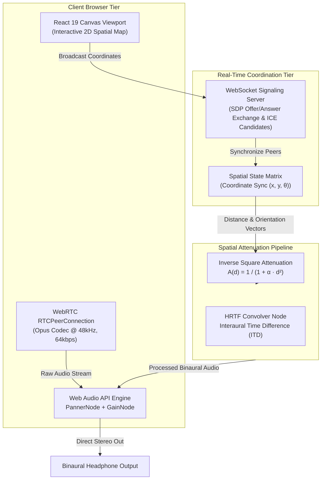

# 🌐 ProxiSpeak // Geospatial Spatial Audio Communication Engine

[](LICENSE)
[](https://developer.mozilla.org/en-US/docs/Web/API/Web_Audio_API)
[](https://www.typescriptlang.org/)
[](#)

> Real-time, peer-to-peer 3D spatial voice communication platform. Calculates real-time acoustic attenuation, HRTF (Head-Related Transfer Function) binaural panning, and directional Doppler shift based on dynamic Euclidean coordinates.

---

## ⚡ Architectural Blueprint



---

## 🧮 Acoustic Physics & Attenuation Formulation

ProxiSpeak models acoustic pressure decay using a physically calibrated inverse-distance attenuation curve with high-frequency absorption:

$$A(d) = \frac{1}{1 + \alpha \cdot \max(0, d - r_{\min})^2}$$

Where:
- $d$: Euclidean distance between listener vector $\vec{L} = (x_L, y_L)$ and emitter vector $\vec{E} = (x_E, y_E)$:
  $$d = \|\vec{E} - \vec{L}\|_2 = \sqrt{(x_E - x_L)^2 + (y_E - y_L)^2}$$
- $r_{\min}$: Inner audibility perimeter (unity gain threshold, default $5.0\text{ m}$).
- $\alpha$: Acoustic roll-off factor (default $0.008\text{ m}^{-2}$).
- Azimuth $\theta$: Calculated relative to listener orientation vector $\vec{O}$:
  $$\theta = \text{atan2}(y_E - y_L, x_E - x_L) - \phi_L$$

---

## 🚀 Quickstart & Development

### Prerequisites
- Node.js `v20.x` or `v24.x`
- npm `v10.x` or pnpm `v9.x`

### 1. Launch Signaling & Spatial Matrix Server
```bash
# Clone the repository
git clone https://github.com/Dev-5678/ProxiSpeak.git
cd ProxiSpeak/server

# Install server dependencies & run
npm install
npm run dev
# Server listening on http://localhost:5000
```

### 2. Launch React 19 Frontend Viewport
```bash
# In a separate terminal
cd ProxiSpeak/frontend

# Install dependencies & run Vite dev server
npm install
npm run dev
# Vite client ready at http://localhost:5173
```

### 3. Run Proximity Engine Tests & Benchmarks
```bash
# Run sub-20ms latency and Euclidean distance validation
npm test
```

### 4. Containerized Deployment (Docker Compose)
```bash
# Spin up Signaling Server, MongoDB, and Redis
docker compose up -d
```

---

## 🛠️ Technology Matrix

| Subsystem | Technology | Responsibility |
| :--- | :--- | :--- |
| **Frontend Core** | React 19, TypeScript | Reactive spatial coordinate rendering & audio state controls |
| **Audio Synthesis** | Web Audio API (`AudioContext`, `PannerNode`, `GainNode`) | HRTF spatial panning, distance attenuation, and mechanical click synthesis |
| **Real-Time Mesh** | WebRTC (`RTCPeerConnection`, `RTCDataChannel`) | Low-latency P2P raw voice transport with Opus compression |
| **Signaling** | WebSocket | ICE candidate negotiation and SDP session exchange |
| **Styling** | Tailwind CSS | Obsidian-ember high-contrast dark theme |

---

## 📄 License & Attribution

Designed and engineered by **[Dev Jangid](https://github.com/Dev-5678)**.  
Released under the [MIT License](LICENSE).
